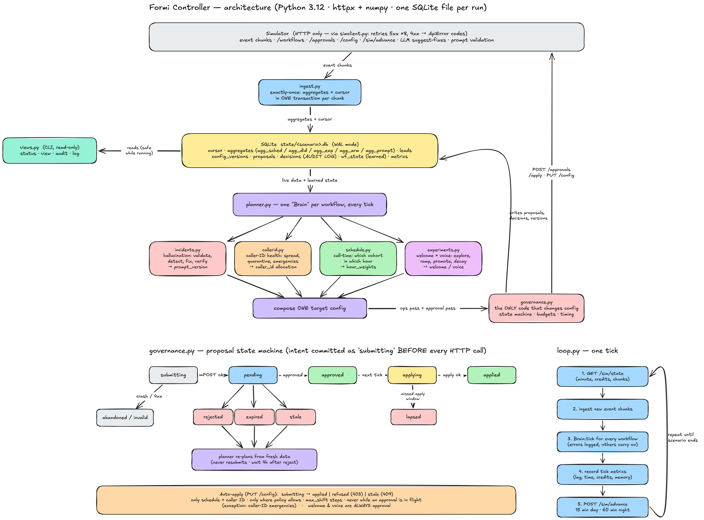
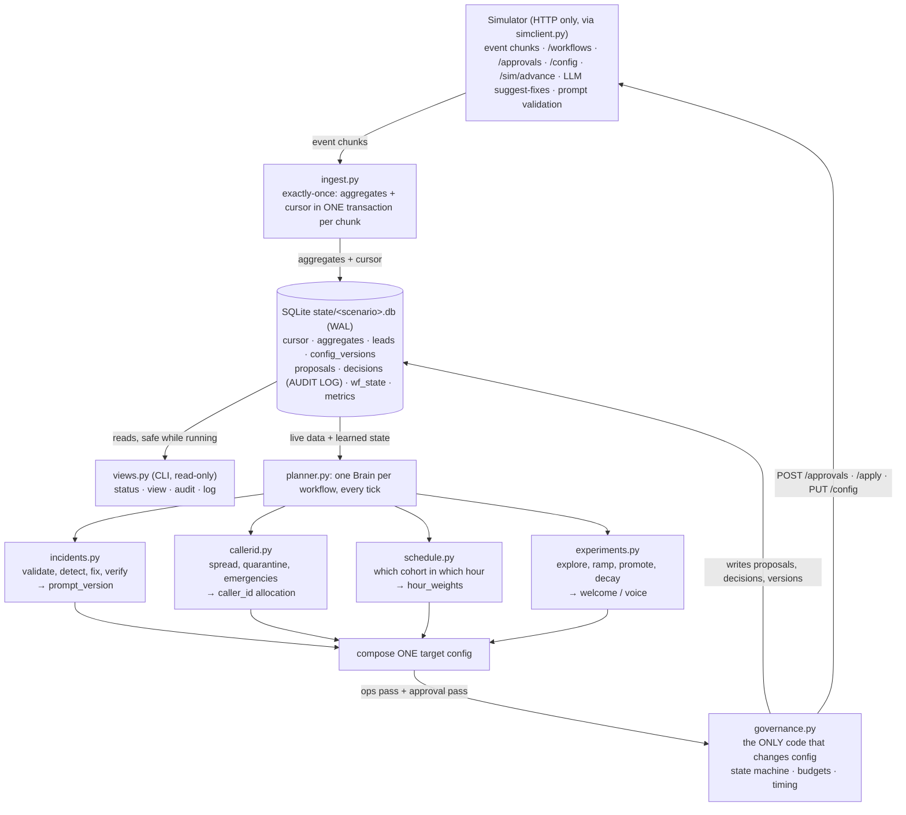
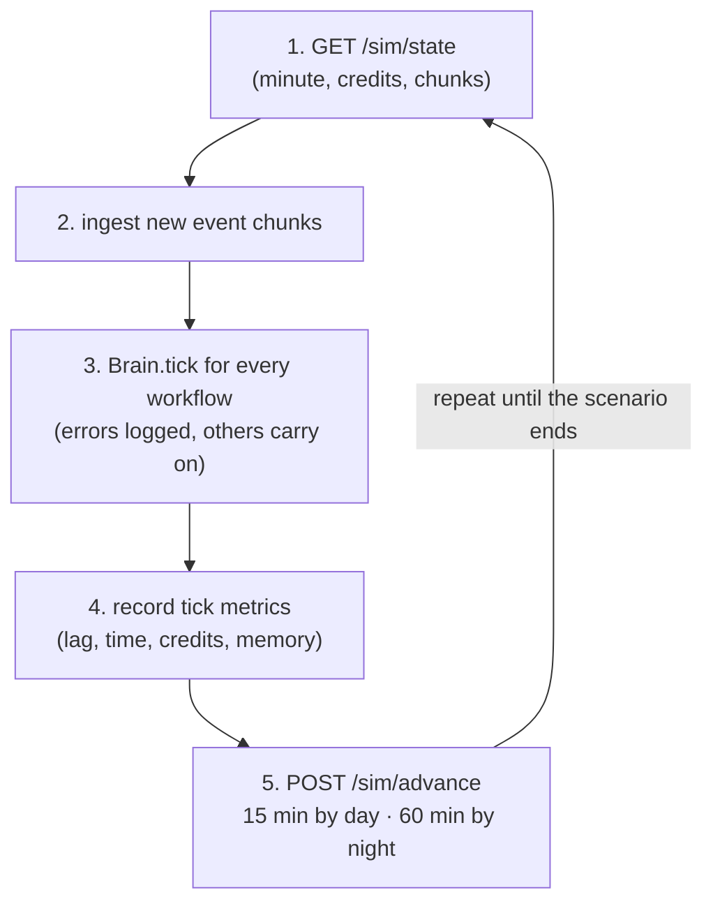
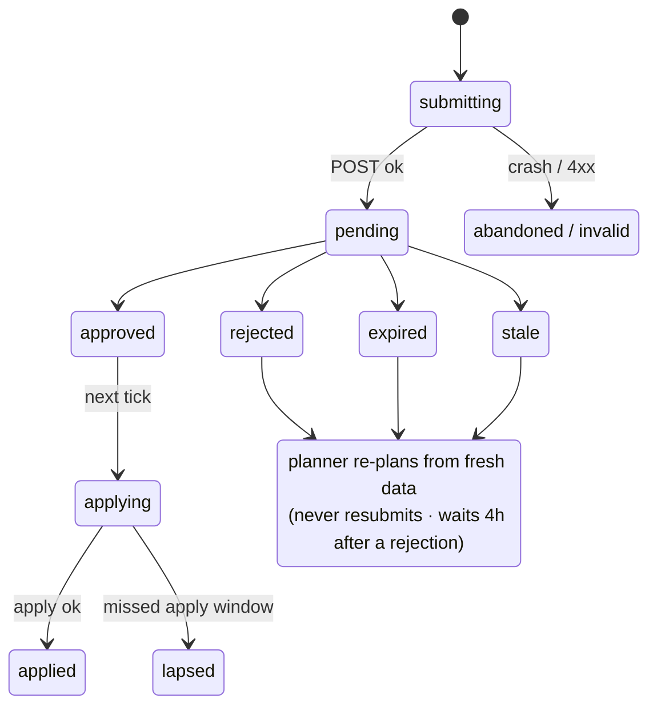

# Formi Controller: an outcome-first agent loop

An always-on controller that tunes outbound voice-agent workflows on its own (caller ID, call time, welcome
message, voice and prompt) while staying inside a strict governance boundary. It talks to the platform
**only over HTTP**, sends every change through approvals or policy-permitted auto-apply, survives being
killed at any point, and can explain every change from its own audit store.

Python 3.12 · `httpx` + `numpy` · one SQLite file per run · no other infrastructure.

| Scenario | Conclusion rate vs baseline | Harmful changes | Notes |
|---|---|---|---|
| `public_01_dev` | **+11.4%** (pickup +7.2%, engagement +2.5%) | 0 | 0 credits used |
| `public_02_incidents` | **+25.6%** (pickup +21.7%, engagement +0.7%) | 0 | Bad-prompt incident fixed in 90 min, 6 credits |
| 6 repeat runs | 01: +11.4…12.6% · 02: +25.6…30.4% | 0 in all | |
| `public_03_load` | ~32 s wall-clock per simulated day | | 840k events/day, peak RSS 458 MB |

> The original assignment brief is in [docs/ASSIGNMENT.md](docs/ASSIGNMENT.md). The full write-up, with
> stakeholder replies and every number's source, is in [SUBMISSION.md](SUBMISSION.md).

---

## Architecture





### The components

| Component | File | Responsibility |
|---|---|---|
| **HTTP client** | [`controller/simclient.py`](controller/simclient.py) | Retries 5xx and network errors up to 8 times with backoff. Turns 4xx into `ApiError` codes, which are answers, not failures |
| **Ingestion** | [`controller/ingest.py`](controller/ingest.py) | Reads history, then live event chunks. Joins each call to its lead's features. Writes aggregates **and** the cursor in one transaction per chunk, so every event counts exactly once, even across a crash |
| **Store** | [`controller/store.py`](controller/store.py) | One SQLite file in WAL mode: cursor, aggregates (`agg_sched`, `agg_did`, `agg_exp`, `agg_arm`, `agg_prompt`), leads, config versions, proposals, the `decisions` audit log, learned `wf_state`, and loop `metrics` |
| **Planner** | [`controller/planner.py`](controller/planner.py) | One `Brain` per workflow, run every tick. Calls the four levers, composes **one** target config, and builds each request (summary, diff, affected leads, dry run, impact score, rationale) |
| **Incidents** | [`controller/incidents.py`](controller/incidents.py) | Hallucination response: validate new prompts on arrival, detect live spikes, choose a known-good fix (or ask the LLM), validate it, propose with evidence, verify after apply |
| **Caller ID** | [`controller/callerid.py`](controller/callerid.py) | Explore unproven numbers, spread load evenly, quarantine weak numbers, detect sudden collapses (spam flags) with a version-stratified two-sample test |
| **Call time** | [`controller/schedule.py`](controller/schedule.py) | Picks the feature with the strongest hour interaction (χ² test on history) and sets per-cohort `hour_weights` from shrunk pickup rates |
| **Experiments** | [`controller/experiments.py`](controller/experiments.py) | Welcome × voice factorial experiments: explore (10%) → ramp (20%) → promote (80% plus a 20% holdout), with stratified, Bonferroni-corrected tests, decay detection and rollback |
| **Governance** | [`controller/governance.py`](controller/governance.py) | **The only code that changes config.** Proposal state machine, request budgets, approver-hour timing, auto-apply rules, crash reconciliation |
| **Views** | [`controller/views.py`](controller/views.py) | Read-only CLI over the store, safe while the controller runs: `status`, `view`, `audit`, `log` |
| Shared helpers | [`cohorts.py`](controller/cohorts.py) · [`configs.py`](controller/configs.py) · [`stats.py`](controller/stats.py) · [`timeutil.py`](controller/timeutil.py) | The one shared cohort object; config semantics (changed dims, TV shift); deterministic statistics; `D3 14:00` time labels |
| Main loop | [`controller/loop.py`](controller/loop.py) | Ingest → decide → advance; DB selection on restart; per-tick metrics |

---

## One tick of the loop (`loop.py`)



Inside `Brain.tick`, in order:
1. Read the live config and notice new versions (supervisor edits).
2. Poll in-flight proposals and apply approved ones.
3. Run the incident flow.
4. Run the caller-ID emergency check.
5. Hourly: the experiment decay monitor. Daily at 07:00: the schedule, caller-ID and guardrail plans.
   At 10:00, 13:00 and 16:00: experiment decisions.
6. **Ops pass:** auto-apply operational changes where policy allows.
7. **Approval pass:** send at most one batched request.

Every chunk is drained before deciding, so decisions never run on stale data.

---

## Governance: the proposal state machine (`governance.py`)

The intent is committed as `submitting` **before** every HTTP call. A crash at any point is then resolved
by asking the platform what actually happened.



**Auto-apply** (`PUT /config`): `submitting → applied | refused (403) | stale (409)`.
- Only for **schedule** and **caller ID**.
- Only where the workflow's policy allows it.
- Only in `max_shift` steps.
- Never while an approval is in flight. Exception: caller-ID emergencies, where safety wins and the
  approval is re-planned.
- **Welcome message and voice always go through approval**, even where policy would allow auto-apply,
  because they are customer-facing.

**Request budgets and timing:**
- Requests per rolling 24h = `min(policy cap − 1, tenant preference)`. One slot is always kept free for
  incidents and rollbacks.
- A request is sent only when the approver's worst-case decision time still falls inside the TTL.
- Result: 0 expired, 0 lapsed and 0 apply conflicts in every run.

---

## Quick start

```bash
# setup (run.sh also does this on first use)
python3 -m venv .venv && .venv/bin/pip install -r requirements.txt

# the contract: start a simulator, then run the controller until the scenario ends
.venv/bin/python -m sim serve --scenario scenarios/public_01_dev.yaml --run-dir runs/mine01   # :8700
./run.sh http://127.0.0.1:8700

# or do it all in one go: fresh simulator + controller + grade vs baseline → reports/
scripts/run_scenario.sh scenarios/public_01_dev.yaml
scripts/run_scenario.sh scenarios/public_02_incidents.yaml
```

### Look inside a run (safe while it runs)

```bash
DB=state/public_02_incidents.db
.venv/bin/python -m controller status --db $DB                                           # on-call: lag, decisions/h, credits, RSS, alerts
.venv/bin/python -m controller view   --db $DB --workflow ks_cancel --at "D3 18:00"     # the supervisor's one screen
.venv/bin/python -m controller audit  --db $DB --workflow ks_cancel --at "D3 14:00"     # why / who / what happened next
.venv/bin/python -m controller log    --db $DB --workflow nw_renewal --kind incident    # raw decision trail
```

`audit` answers *"why did X change at time T, who approved it, and what happened next?"* from our own store.

### Tests and evidence

```bash
.venv/bin/python -m pytest -q tests                                  # 17 tests, incl. an A/A false-winner-rate test
scripts/crash_test.sh scenarios/public_02_incidents.yaml 5           # 5 random SIGKILLs + restarts, then verify invariants
scripts/load_test.sh 2 2                                             # public_03 at full daily rate (use `7 5` for the full run, ~4 GB disk)
CONTROLLER_ABLATE=did,schedule,exp scripts/run_scenario.sh scenarios/public_02_incidents.yaml   # switch levers off
```

---

## Guarantees

| Guarantee | How |
|---|---|
| **Governance boundary** | Only `governance.py` changes config, always through `/approvals` or policy-permitted auto-apply. Supervisor edits are recorded and never silently reverted |
| **Crash safety** | Intent committed before every call; deterministic proposal ids; `reconcile()` via `GET /approvals` and config history. Crash test: 5 SIGKILLs, no duplicate or lost proposals, nothing applied twice, **245,008 / 245,008 events counted** |
| **Exactly-once ingestion** | Aggregates and cursor in one transaction per chunk |
| **Separate KPIs** | Pickup and engagement are never blended; each workflow optimises its primary KPI and checks its guardrail |
| **Statistical, deterministic winners** | CMH test stratified by (config version, cohort), Bonferroni-corrected, ≥ 300 connected per arm, fixed looks at 10:00 / 13:00 / 16:00. Measured false-winner rate ≈ 6% per 8-day experiment. The LLM only proposes candidates |
| **Population thresholds** | Every detector needs hundreds of calls and a strict p-value or z-score; nothing reacts to one call |
| **Auditability** | Every decision is in the `decisions` table, queryable with `audit` and `log` |
| **Credits** | Prefer a known-good prompt revert (validation only) over LLM calls: 6 credits for the whole public_02 incident |

---

## Results in detail

What each lever is worth (ablation on public_02, [reports/ablation_public_02.txt](reports/ablation_public_02.txt)):

| Configuration | Conclusion-rate lift |
|---|---|
| Everything on | +26–30% |
| Without caller-ID rotation | +8% |
| Without call time | +26% |
| Without experiments | +27% |
| All three off | +7% |

Caller-ID load-spreading is the dominant lever.

**public_02 incident timeline:**
- **Spam-flagged caller ID:** detected about 2 hours after onset, and at 0% share by the next day.
- **Supervisor's bad prompt:** validated the moment it shipped (0.937 < 0.97). Reverted to the known-good
  prompt through an approval with evidence; MTTR **90 minutes**. Hallucinated calls: **71 vs 348** in the
  baseline.
- **Decaying welcome message:** removed by day 6 in every run.

All reports are in [reports/](reports/).

---

## Repository layout

```
controller/          the controller (see the components table above)
  tenant_prefs.json  client preferences stricter than policy (e.g. Kestrel: ≤ 2 requests/day, not before 11:00)
run.sh               starts the controller; creates .venv on first use
scripts/             run_scenario.sh · crash_test.sh + verify_crash.py · load_test.sh + load_report.py
tests/               test_controller.py (ours) · test_sim.py (simulator)
reports/             graded runs, load numbers, crash log, ablation, audit/view/status samples
docs/
  ASSIGNMENT.md      the original assignment brief
  SIMULATOR.md       the simulator API contract
  CONTROLLER.md      runbook: run, debug, extend
  images/            architecture diagram
SUBMISSION.md        the full submission: design, statistics, governance, scale, stakeholders
sim/ scenarios/ stakeholders/ examples/   provided with the assignment (sim/ is not modified)
```

Run-time output, not committed: `state/` (SQLite stores), `logs/`, `runs/` (simulator output).

---

## Documentation

| Read this | If you want to |
|---|---|
| [docs/CONTROLLER.md](docs/CONTROLLER.md) | run, debug or extend the controller (decision kinds, invariants, recipes) |
| [SUBMISSION.md](SUBMISSION.md) | understand the design choices, trade-offs, scale analysis and stakeholder replies |
| [docs/SIMULATOR.md](docs/SIMULATOR.md) | see the platform API the controller is built against |
| [docs/ASSIGNMENT.md](docs/ASSIGNMENT.md) | read the original brief |

## Known limitations

- A promoted winner that starts to decay takes about 1.5–2.5 days to roll back (limited by the 20% holdout).
- Segment-level winners are rarely found within 8–10 days at the strict significance bar.
- Call time is per cohort, not per person (too few calls per person to support it).
- Quarantined caller IDs are never re-probed.
- At 10× scale, single-process ingestion and the in-memory lead map are the first bottlenecks. The plan is
  to shard by tenant (see SUBMISSION.md §8).
