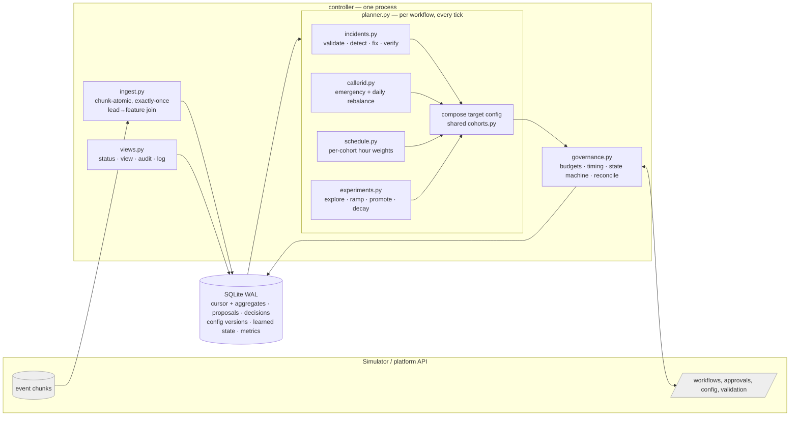

# Outcome-First Agent Loop — Submission

**Name:** Aayush Goswami · **Date:** 2026-11-06 · **Hours actually spent (be honest):** _fill in_ · **Language / storage:** Python 3.12 (numpy, httpx; both already in `requirements.txt`) / SQLite (WAL), one file per scenario run

> Runbook for whoever is on call: [docs/CONTROLLER.md](docs/CONTROLLER.md). Every number below comes from files in
> [reports/](reports/) and can be regenerated with the scripts in [scripts/](scripts/).

---

## 0. TL;DR

- One Python process drives the simulator in 15-minute ticks. Each tick it ingests events exactly once into SQLite aggregates, runs four levers per workflow (caller-ID health, per-cohort call time, welcome × voice experiments, hallucination incident response), and sends every change through one governance client. Every decision lands in an audit table that a CLI can query.
- **public_01: +11.4% conclusion rate, +7.2% pickup, +2.5% engagement vs baseline. public_02: +25.6% / +21.7% / +0.7%.** Zero harmful changes in the final runs. Across 6 consecutive validation runs: conclusion +11.4…12.6% (01) and +25.6…30.4% (02), and **0 harmful changes in all 6**.
- public_02 incidents:
  - The flagged caller ID was detected within ~2h and was at 0% share the next day.
  - The supervisor's bad prompt was validated at the moment it shipped. It was fixed through an approval with evidence (grader MTTR 90 min; 90–300 min over 6 runs) for 6 credits.
  - The decaying welcome message was out by day 6 in every run.
- Load: **~32 s wall-clock per simulated day** at the full public_03 rate (840k events/day, 12 workflows). That's ~18× headroom against SRE's 10-minute target. Peak RSS is 458 MB. Kill/restart: 4–5 SIGKILLs mid-run, all invariants hold.
- Deliberately not built:
  - per-person call time (Product's headline ask);
  - fair cross-tenant allocation (C15);
  - proactive prompt optimisation;
  - welcome/voice experiments on pickup-primary (KYC) workflows;
  - a UI (the supervisor view is a CLI).

## 1. Assumptions

1. **The simulator's contract is the truth, not the memos.** Policy comes from `GET /workflows` at start-up, and nothing is hard-coded per tenant except the stricter soft preferences in `controller/tenant_prefs.json` (sourced from memo 04).
2. Pickup rate = connected ÷ dials and engagement = engaged ÷ connected, per workflow, never blended (memo 05).
3. **`guardrail.*_max_drop` is an absolute drop in the rate** (0.02 = 2 percentage points), compared against the pre-D0 history of the same workflow. The relative reading would make ordinary noise a breach: we measured ±2–3% relative swings in nw_kyc engagement **with every lever switched off** (see §11).
4. Welcome message and voice act after the person picks up, so they can't move pickup. On pickup-primary workflows we don't spend approvals on them.
5. A supervisor edit is a deliberate business decision. We record it and never revert it silently. If it is unsafe, we propose a fix to the approver with evidence. Dimensions a supervisor sets on welcome/voice are left alone for the rest of the run.
6. "Who approved" = the workflow's tenant approver as identified by `approval_id`. The simulator exposes no named person, so our store keeps the approval id, request time, decision time and apply time.
7. Credits are scarce in production (memo 06): we spend them only when a decision depends on the result.
8. The business owns *how many* calls per hour (capacity). Hour weights only change *who* is dialled, and every hour in the window keeps a weight > 0, so no capacity is wasted.
9. One controller process per platform shard. Scale-out is by partitioning workflows (§8). No new stateful infra: SQLite here, the existing Postgres in production (memo 03).
10. The approver's "judgement call" rejections are random and carry no information about the change. We back off 4h and re-plan from fresh data, and never resubmit the same proposal.

## 2. Scope decisions

| # | Capability | Built / Partial / Cut | Why | What it would take to finish |
|---|---|---|---|---|
| C1 | Event ingestion at load scale | **Built** | Floor for everything. Chunk-atomic, exactly-once, 60–80k events/s | Per-shard ingestion workers (§8) |
| C2 | Lead/feature joins + one shared cohort object | **Built** | Memo 05's hard requirement. `cohorts.py` is the only cohort definition: config, schedule, experiments, view | — |
| C3 | Bootstrapping from history | **Built** | Hour profiles, DID baselines, hallucination-flag baseline, known-good prompt evidence | — |
| C4 | Call-time optimisation | **Partial: per cohort** | Statistically supportable with history. Per-person is not (see memo 05 reply) | Per-person posterior on archetype × hour, gated on ≥ N connects per person |
| C5 | Caller-ID health | **Built** | Largest single lever (ablation: −20pp without it). public_02 incident | Re-probe of quarantined DIDs after cool-off |
| C6 | Welcome × voice experiments | **Built** | Core engagement lever | Adaptive (bandit) allocation where auto-apply allows it |
| C7 | Promotion, decay, rollback | **Built** | Decaying winners exist and hurt customers | Faster decay power (bigger holdout or a CUSUM) |
| C8 | Hallucination incident response | **Built** | Customer safety. public_02 incident | Multi-candidate A/B of fixes is impossible (one prompt per workflow) |
| C9 | Governance client | **Built** | Mandatory, and graded on hygiene | Cross-workflow batching per approver |
| C10 | Impact score, affected leads, dry run | **Partial** | Honest formulas from our data, labelled with their caveats | Counterfactual replay simulator for schedule/DID load effects |
| C11 | Supervisor view | **Partial: CLI** | One screen per workflow; same store as the audit | Web page over the same queries |
| C12 | Decision/audit store + query | **Built** | Floor, and the live-review question | — |
| C13 | Crash recovery, demonstrated | **Built** | Memo 03 non-negotiable | — |
| C14 | Loop observability | **Partial** | `metrics` table + `status` CLI: lag, decisions/h, credit burn, memory, alerts | Export to the existing Prometheus/Grafana |
| C15 | Fair credit/attention allocation across tenants | **Cut** | Per-workflow caps already prevent one tenant starving another at this scale | Global token bucket for credits; approver-queue scheduler |

**Principle.** Build what moves the business outcome or prevents harm, in that order, and make it auditable. Safety and governance capabilities (C1, C8, C9, C12, C13) were non-negotiable. Among the optimisation levers I built the ones with a credible statistical basis on the data we actually get: caller-ID health, per-cohort call time and the staged experiments. I cut the ones whose evidence base is too thin (per-person call time) or whose value doesn't reach this scale (C15). The ablation in §11 vindicated the ordering: caller-ID load-spreading is worth more than everything else combined.

## 3. Stakeholders

### 01 — Nikhil Rao, VP Sales
- **Accepted:** speed where policy allows. Operational changes (caller ID, call time) auto-apply the same day. Winners are promoted the moment the evidence clears the bar, not at a weekly review.
- **Declined:**
  - **A blended score.** Pickup and engagement are separate KPIs by product definition, and blending hides harm to one of them.
  - **"Winning by lunch → live by evening".** A half-day of data is ~150 connected calls per arm. That can't separate +10% from noise, and our A/A test shows the false-winner rate would explode. Approver latency alone is 30–480 min.
  - **"Rolling out the persuasive prompt everywhere".** The LLM never decides, prompt changes need validation evidence, and "persuasive" (P4) is not even an option on nw_kyc.
- **Wrong claims:**
  - "Kestrel has turned on auto-apply for everything": ks_cancel auto-applies only schedule, caller ID, welcome and voice, with `max_shift 0.2`. Never prompts or cohorts, and never a 100% "push the winner".
  - "Northwind is fine with auto-apply on KYC": nw_kyc has `auto_apply.enabled: false`, and Northwind Compliance requires a named human approval.
- **Reply:**
  > Nikhil — happy to give you real numbers for the summit: on the test scenarios the agent lifted leads concluded by 11–30% per scenario, with every change explained and approved. Two things I can't do. A single blended score: pickup and engagement are separate by product definition, and a blend hides harm. And "winner by lunch, live by evening": half a day is too little data, and we'd promote noise to real customers. Also, Kestrel's auto-apply doesn't cover prompts or full rollouts, and Northwind KYC has auto-apply off. I'll give you one slide per client with both KPIs and the business outcome.

### 02 — Meera Iyer, Head of Compliance, Northwind
- **Accepted, all of it:**
  1. Every customer-facing change (welcome, voice, prompt, cohort allocation) goes through `/approvals`.
  2. Prompt changes carry a `validation_run_id`.
  3. Requests are timed so the approver can decide inside 10:00–19:00 (KYC 10:00–18:00) before the TTL. We never send a request whose worst-case decision would fall outside approver hours past its TTL.
  4. "Slow and right" is built in: Bonferroni-corrected winners, harm early-stop, decay rollback, and 0 harmful changes in 6 test runs.
  5. The audit CLI answers "why did a customer hear X on day D" from our own store: it gives the variant distribution live for that customer's cohort and the proposal that put it there (§10).
- **Pushed back:** nothing substantive.
- **Wrong claim:** "operational settings are covered by the policy we signed" is true for **nw_renewal only**. nw_kyc has auto-apply disabled, so even caller-ID and call-time changes on KYC go to your approver.
- **Reply:**
  > Meera — we built to your conditions. Nothing a customer hears changes without your approver: welcome, voice and script changes all go through approval, and script changes carry a validation run. Requests are only sent when your approvers can decide them inside 10:00–19:00 (KYC 10:00–18:00). For any customer and day we can show, from our own records within minutes, which variant mix was live for them and the approved request that put it there. One correction: on KYC even call timing and caller-ID rotation need your approval, because auto-apply is off for that workflow. The weekly summary will list every operational change on Renewal.

### 03 — Kabir Menon, Platform & SRE
- **Accepted:**
  - **Kill safety** (§9): 5 SIGKILLs at random moments plus restarts; all invariants hold (`reports/crash_recovery.log`).
  - **Idempotency everywhere:**
    - deterministic proposal ids, with the intent written before every POST/PUT;
    - reconciliation through `GET /approvals` and `config/history`;
    - chunk-atomic ingestion.
  - **No new stateful infra:** SQLite is a file inside the controller's volume, and the schema maps 1:1 to the Postgres you already run.
  - **Loop health without logs:** `python -m controller status`.
  - **Throughput:** one load-scenario day takes ~32 s wall-clock, of which ~21 s is ours.
- **Pushed back:** nothing. The 10× analysis is in §8.
- **Wrong claims:** none.
- **Reply:**
  > Kabir — evidence rather than promises. `scripts/crash_test.sh` SIGKILLs the controller five times mid-run and checks every invariant: no proposal sent twice, none lost, no apply conflicts, every event counted exactly once (245,008 = 245,008). `controller status` shows ingest lag, decisions/hour, credit burn and memory. A full public_03 day takes ~32 s wall-clock on a laptop with 458 MB peak RSS. The only state is one SQLite file, and in production it's a schema in your Postgres. Pages are for incidents only (§10). The first bottleneck at 10× is single-process ingestion; the partitioning plan is in the doc.

### 04 — Anita Desai, Operations Supervisor, Kestrel
- **Accepted:**
  - **At most 2 normal requests a day, never before 11:00.** This is stricter than policy (4/day from 10:00), so we honour it. One extra slot is used only for incidents and rollbacks.
  - **Batching:** one request per workflow per decision carries every change.
  - **We never touch her prompt edits behind her back.** Her P2 script was validated the minute it went live, and the fix went to her approver with the evidence.
  - **One screen:** `python -m controller view --workflow ks_cancel`.
  - **No "word for word" fix:** we prefer a prompt with *production* engagement evidence (her previous P1) over an unknown one that merely passes a safety check.
- **Pushed back:** none, really. We went further than she asked: policy allows auto-apply of welcome/voice on Kestrel, but **we don't use it**. Customer-facing changes always go to the approver, so she always knows what customers heard.
- **Wrong claim:** none about policy. Her worry is correct, though: policy *would* let an automated system change what customers hear on running campaigns without telling her.
- **Reply:**
  > Anita — we will never undo your edits quietly. When you shipped the new script, we validated it immediately. It failed the safety check (93.7% vs the required 97%), so we sent your approver a request to go back to the previous script, with the evidence attached; nothing changed until they approved. You'll get at most two requests a day, none before 11:00, each batching everything. A third only comes for a safety incident. `controller view` gives you one screen: what's being tested, what's winning, what we need from you, what changed today. We won't push a "safe but boring" script: we prefer ones with proven engagement on your calls.

### 05 — Tara Kulkarni, Head of Product
- **Accepted:**
  - **Separate KPIs:** everywhere, including the view.
  - **One shared cohort object:** `cohorts.py`, deterministic ids such as `age_band=60+&lang=hi`.
  - **Proposals as a product surface:** each one carries an impact score, diff, affected leads and dry run (§6). The impact score is documented and capped so that safety items always rank above optimisations.
  - **Expired = rejection:** we re-plan from fresh data and never resubmit.
  - **Only what happened counts:** analysis uses the variant recorded on each call event, never our intent.
  - **Winners stay in their workflow.**
- **Minimum cohort size / window, the cost made explicit:**
  - promotion needs ≥ 300 connected calls per arm and z ≥ Bonferroni(α=0.01) ≈ 2.9 for 5 challengers;
  - at ~1,000 connected/day with a 10–20% arm, that's 2–4 days to detect a +10–15% effect;
  - the measured false-winner rate is **≈6% per 8-day experiment** (A/A test, 120 runs);
  - halving the bar would roughly halve the time and roughly triple the false winners.
- **Declined:** **per-person call time as the headline.**
  - Per-person history is 2–5 dials, mostly no-answers.
  - The mechanism multiplies a person's weight by 6 in one hour and by 0.25 in every other hour, so a wrong guess makes the person *harder* to reach.
  - Per-cohort call time ships instead.
  - Even so, call time is a small lever on these scenarios (~+1pp in the ablation). Caller-ID health is the big one, so it's the better summit headline.
- **Reply:**
  > Tara — definitions held: separate KPIs, one cohort object used by detection, experiments and the view, and every proposal carries impact, diff, affected leads and a dry run. Minimum sample: 300 connected calls per arm, Bonferroni-corrected. That means 2–4 days per decision and about a 6% chance of a false winner per experiment, measured. I didn't build per-person call time: there are too few calls per person, and a wrong guess makes them harder to reach. Per-cohort call time is live. Caller-ID health turned out to be the biggest lever (−20pp without it), so I'd make that the headline.

### 06 — Aryamann, CTO
- **Accepted:**
  - **Explainable over clever:** every change has a rationale, evidence and an audit query.
  - **Hurting a cohort is worse than nothing:** harm early-stop, decay rollback, novelty retirement, and 0 harmful changes in 6 runs.
  - **Best compute is no compute:** 6 credits spent on public_02 out of 200. No LLM call was needed because a known-good prompt existed.
  - **Scale:** §8.
  - **Choosing:** §2, with the cuts named.
- **Pushed back:** nothing.
- **Wrong claims:** none, but the memos had several, listed under each memo above.
- **Reply:**
  > Aryamann — I chose caller-ID health, per-cohort call time, staged welcome/voice experiments with decay rollback, prompt incident response and the governance/audit spine. I said no to per-person call time, blended scores, Sales' auto-apply shortcuts and cross-tenant credit fairness. Result: +11% (01) and +26% (02) conclusion rate, 0 harmful changes over 6 runs, 6 credits spent. What breaks first at 10× is single-process ingestion, and the partition plan is in §8. The weakest part is decay detection on small holdouts: it takes 1–2 days.

## 4. Architecture



**Loop:** `GET /sim/state` → ingest every new chunk → for each workflow `Brain.tick()` → `POST /sim/advance 15` (60 min between 22:00 and 07:00). Each tick, in order:
1. Read the live config.
2. Notice new versions (supervisor edits).
3. Poll and apply in-flight proposals.
4. Run the incident flow.
5. Run the caller-ID emergency check.
6. Hourly: experiment monitor. Daily at 07:00: schedule, caller-ID and guardrail plans.
7. Ops pass (auto-apply).
8. Approval pass (one batched request).

**State and where it lives** (all in `state/<scenario>.db`):

| What | Table |
|---|---|
| Ingest cursor | `meta` |
| Aggregates | `agg_sched` (day × hour × feature-code), `agg_did` (hour × version × caller ID), `agg_exp` (day × version × cohort × welcome × voice × feature-code), `agg_arm` (hour × version × cohort × arm), `agg_prompt` (hour × version × prompt: KPIs + flags) |
| Leads and feature codes | `leads`, `codes` |
| Config versions with configs | `config_versions` |
| Proposals with full request | `proposals` |
| Approval events | `approval_events` |
| Learned state per workflow (JSON) | `wf_state` |
| Audit decisions | `decisions` |
| Loop metrics | `metrics` |

**On restart:**
- Ingestion resumes from the cursor; the chunk in flight is re-read because its transaction never committed.
- `reconcile()` resolves every proposal left in `submitting` or `applying` by asking the simulator.
- Learned state is reloaded from `wf_state`.
- The lead→feature map for active campaigns is rebuilt from `leads`.

If the *simulator* was restarted (a new world), the DB is archived and a fresh one started.

## 5. The learning loop

- **Cohorts.**
  - *How they're formed:* a partition, the cartesian product of a short list of features, at most 20 cells, disjoint and exhaustive.
  - *Which features:* the call-time feature is chosen by a likelihood-ratio test of the hour × value interaction on history (age_band wins on all three public workflows, p between 1e-17 and 1e-25). A feature is added only if a *segment-level* winner needs it and the product stays ≤ 20.
  - *Avoiding fragmentation:* population-wide policy lives in `default`, and cohort overrides exist only where a cohort-specific winner exists, so traffic isn't fragmented.
  - *Minimum size:* a schedule cell needs enough dials for shrunk rates (pseudo-count 200). An experiment segment needs ≥ 300 connected per arm.
- **Experiment design.**
  - Welcome and voice are randomised *independently* per call, so one allocation is a factorial: both main effects come from the same traffic, and the cross cells allow interaction checks.
  - Staged: challengers start at 10%, move to 20% when trending better (z ≥ 1 *against what they'd displace*, and the last 24h agree), and control keeps ≥ 55–70%.
  - Staging is forced by governance: every allocation change is an approval (2–3/day), so we can't run an hourly bandit. Exploration shares bound worst-case harm at apply time: a −10% arm at 10% costs −1%.
- **Deciding a winner.**
  - *Test:* a two-proportion test on engagement, **stratified by (config version, cohort)** with CMH weights. Each stratum is a clean randomised A/B, which avoids Simpson's paradox when allocations change (unit-tested).
  - *Population-level promotion requires all of:*
    - z ≥ Bonferroni(α=0.01, all challengers);
    - ≥ 300 connected per arm;
    - lift ≥ 3%;
    - the last 24h lift still ≥ 3%;
    - no downward trend (last-2-day vs earlier DiD z > −1);
    - pickup not significantly worse.
  - *Segment-level promotion:* Bonferroni over challengers × segments (z ≈ 3.6), plus the same recency checks.
  - *Looks:* decisions are taken at three fixed looks a day (10:00, 13:00, 16:00) to limit repeated-testing inflation.
  - *False-winner rate:* **≈6% per 8-day experiment** (A/A simulation, 120 runs, `tests/test_controller.py`).
- **Decay and rollback.**
  - *Promoted winners* keep a 20% control holdout. Every hour we compare the winner's last 24h against the control's last 72h, stratified by cohort. A winner is suspected if z ≤ −2, or if its DiD against the **lower 90% bound** of its lift at promotion is ≤ −2 and the lift is negative. Using the lower bound is a winner's-curse correction: the point estimate caused a false rollback in testing. It is rolled back once, ≥ 6h later, it's flagged again or the lift is ≤ −3%.
  - *Arms still exploring* are dropped if the last 2 days reverse against earlier data (DiD z ≤ −2), if they're significantly negative recently, or if they're futile (upper bound < 3%).
  - *Speed:* public_02's W3 (decays to −10% over 2 days) was at 0% share by day 6 in every final run. Exposure after onset was 0.19–0.20 on days 2–5, mostly as an exploration arm.
- **Call time and caller ID.**
  - *Call time:*
    - history → shrunk pickup per (age band, hour) → weights `(p(c,h)/p̄(c))²`, floor 0.1, so each cohort is dialled in its comparatively good hours;
    - re-planned daily with hysteresis;
    - per-person preferred hours are not used (§3, memo 05).
  - *Caller ID:*
    - unproven DIDs are explored at 5% each (≤ 15% total);
    - traffic is spread equally across healthy measured DIDs, because load depresses pickup;
    - a *low-share* DID < 80% of the best (z ≤ −3) is quarantined;
    - a sudden collapse needs three things together: a two-sample z ≤ −5 vs peers in the same hours and versions, < 60% of expected, and < 60% of its *own* previous-24h pickup.
  - All DID comparisons are **stratified by config version**. On `next_campaign_only` workflows the split is locked per campaign, and unstratified comparisons produced false "collapses" in testing.
- **Guardrail KPI.**
  - Per arm inside experiments: a challenger whose pickup is significantly worse by more than the allowed drop can't be promoted.
  - Daily against the pre-D0 baseline (`guardrail_check`): a breach raises an alert and a decision record.
  - The pickup guardrail on engagement workflows rose (+7–11%) in all runs. nw_kyc's engagement guardrail moved −0.2…−1.8pp, inside the 2pp allowance, and the same drift appears with all levers off (§11).

## 6. Governance

**State machine** (`governance.py`):

```
submitting ─POST ok─▶ pending ─▶ approved ─▶ applying ─▶ applied
    │                   ├─▶ rejected ─┐          └─▶ lapsed (missed apply window)
    │ crash/4xx         ├─▶ expired ──┼─▶ planner re-plans from fresh data (never resubmits)
    ▼                   └─▶ stale ────┘   (base moved, e.g. supervisor edit: we do not even try to apply)
abandoned / invalid
auto-apply:  submitting ─PUT ok─▶ applied | refused (403) | stale (409)
```

- **Re-proposal:** after a judgement-call rejection, back off 4h and re-plan. After expiry or staleness, re-plan at the next sendable slot. Expired counts as rejected (memo 05).
- **Batching and timing:**
  - One normal request in flight per workflow, carrying every pending change.
  - Budget per rolling 24h = min(policy − 1, tenant preference). One slot is always reserved for incidents and rollbacks.
  - Send only when `now ≥ max(approver start, tenant earliest)` and the worst-case decision time (now + max latency, rolled to the next approver morning if it spills) is inside the TTL.
  - Approved requests are applied on the next 15-minute tick, well inside the 2h apply window: **0 lapses, 0 apply conflicts** in all runs.
  - Peak requests/24h: nw_renewal 2 (cap 3), nw_kyc 1 (cap 2), ks_cancel 3 (pref 2 + 1 incident; policy 4).
- **Auto-apply:**
  - Used only for **operational dims (schedule, caller_id)**, where policy allows, when no approval is in flight (an auto-apply would make that approval stale), and in `max_shift` steps.
  - Voluntarily **not** used for welcome/voice on Kestrel, even though policy allows it. Customer-facing changes go to a human (memos 02 and 04).
  - Caller-ID emergencies auto-apply even while an approval is in flight. That makes the approval stale, which is logged, and it is re-planned. Safety wins.
- **Impact score, affected leads and dry run:**
  - *Impact score:* incidents 0.9, caller-ID emergency 0.85, rollbacks 0.8. Optimisations get `min(0.75, expected relative primary-KPI lift / 10% × 0.75)`, floor 0.05. Safety always ranks first, and exploration ranks low because its expected short-term effect is ≈ 0.
  - *Affected leads:* active leads (in-cadence, not concluded) whose effective treatment changes, computed from our lead table. For `next_campaign_only` agent changes, it's the next campaign's size.
  - *Dry runs:*
    - allocation: population-average allocation shift × observed stratified lift per arm, with a CI;
    - schedule: replay of the last 14 days' dials re-weighted by hour;
    - caller ID: the last 72h pickup per DID.
  - *Honesty:* every dry run states its method and caveat (e.g. the schedule replay ignores eligibility depletion).
- **Supervisor edits mid-experiment** (public_02, D5 15:00, nw_renewal voice → V2):
  1. Recorded with the live config.
  2. Voice became supervisor-owned for the rest of the run, and the voice experiment stopped. V2 became the control, with V1/V3 marked `paused_supervisor`.
  3. A pending request based on the old version is marked superseded and never applied.
  4. Non-conflicting work continued.
  5. Evidence from before the edit stays valid, because analysis is stratified by version.

## 7. Incidents

| Detector | Threshold | Expected false-positive rate |
|---|---|---|
| Prompt shipped without our validation | validation pass rate < policy min (0.97), n=300 (3 credits) | P1-quality prompt fails with ≈0.1% probability |
| Live hallucination spike | ≥ 300 connected, rate ≥ max(2×base, base+1pp), exact binomial p < 1e-5 | ≈1 per 25k workflow-days. At 1e-3 we saw one false incident in testing, hence the tighter bar |
| Caller-ID collapse | two-sample z ≤ −5 vs peers (same hours, same versions), < 60% of expected, < 60% of own 24h | ≈3e-7 per look. Earlier versions (z ≤ −4, one-sample, unstratified) raised 3 false collapses in testing |
| Decay | §5 | rollback false-positive: 1 seen at an earlier setting, 0 in the final 6 runs |

**Choosing a fix:**
1. A **known-good prompt** from our production records: ≥ 1,000 connected calls, flag rate not above baseline, best engagement.
2. Only if there is none: `suggest-fixes` (3 credits), then each candidate in order.

Every candidate must pass validation at +0.5pp margin. **Verify:** after apply, ≥ 300 connected calls on the new version with a flag rate no longer elevated; otherwise re-open with the next candidate. **Credit spend on public_02:** 6 (two validations), with no LLM call.

**public_02 timeline** (final run; `controller log --kind incident`, `reports/audit_ks_cancel_D3_1400.txt`):

| Time | Event |
|---|---|
| D2 10:00 | (hidden) ks_cancel caller ID D2 spam-flagged |
| D2 12:00 | `did_flagged`: D2 at 8.0% pickup vs 24.8% expected (z=−5.3), auto-applied off within `max_shift` steps; share D2 8.7% → D3 0% |
| D3 11:30 | Supervisor ships prompt P2 |
| D3 11:45 | We see v10 by supervisor → validate P2: **0.937 < 0.97** → incident opened, PAGE |
| D3 12:00 | Fix chosen: P1 (known-good: 20k connected, 1.5% flags) → validated 0.990 → request sent to the Kestrel approver with both validation runs as evidence |
| D3 12:42 | Approved |
| D3 13:00 | Applied (**grader MTTR 90 min**) |
| D3 16:00 | Verified: 1.63% flags on 307 connected vs 1.52% baseline → resolved |

Hallucinated calls on ks_cancel: **71 vs 348** in the baseline.

## 8. Scale

Measured on `public_03_load` at the full per-day rate: 12 workflows, ~840k events/day. The run was shortened to 2 history + 2 live days because the full 7+5 days writes ~4 GB of simulator files and my disk was full. The per-day numbers are rate-bound, not length-bound. Source: `reports/public_03_load.md`, `scripts/load_test.sh`.

| Metric | Value |
|---|---|
| Ingest throughput | 60–61k events/s live; 81k events/s on history bootstrap (1.34M events in 16.6 s) |
| Wall-clock per simulated day | **30–34 s total**: our ingest 13.8 s + our decisions 5–7 s + simulator 11–13 s. Target 600 s → ~18× headroom |
| Decision step (12 workflows) | p50 0.05 s, p95 0.31 s, max 1.0 s per tick |
| Decision lag | 0 events at decision time (every chunk is drained before deciding); freshness bounded by the 15-min tick |
| Peak RSS | 458 MB (was 1.1 GB; fixed by streaming chunk bytes instead of a UCS-4 `StringIO` copy) |
| Store | 118 MB SQLite for 4 days × 12 workflows |

**What breaks first at 10×** (8.4M events/day, 120 workflows):
1. **Single-process ingestion: ~140 s/day of JSON parsing.** Still inside the budget, but it's the critical path, and the 250k-event history chunk spike peaks around 1 GB.
2. **Per-tick decisions** grow linearly: ~60 s/day at 120 workflows, fine.
3. **SQLite single-writer**: the aggregate upserts at 10× are ~10× today's ~1 s/day, fine. At 100× it becomes the bottleneck → Postgres.
4. **The lead→feature map:** ~770k active leads today → 7.7M at 10× ≈ 1.5 GB in Python dicts. Move it into the store, or key by the integer suffix.

**Partitioning:**
- Shard by `tenant_id` (governance, approvers and credits are per tenant). Each shard runs ingestion and brains for its workflows, with its own cursor over a tenant-filtered event stream.
- Shared state is only the credit budget, as a global token bucket (that's C15).
- Approver attention is already per workflow and tenant.

Because every brain reads only its own workflow's rows, sharding is a configuration change, not a rewrite.

## 9. Reliability

**Method:** `scripts/crash_test.sh` starts a fresh public_02 world, runs the controller, and SIGKILLs it at 4–12 s random intervals (5 attempts; the run sometimes finishes first). It restarts after each kill, runs to completion, then runs `scripts/verify_crash.py`.

**Results** (`reports/crash_recovery.log`, final code):
- 6 controller starts;
- 19 approvals, no duplicate proposal ids;
- none lost;
- terminal states agree with the server;
- nothing stuck in `submitting`/`applying`;
- no proposal applied twice;
- 0 apply conflicts and 0 lapses;
- **245,008 call events on the server = 245,008 counted by us.**

Outcome: +28.2% conclusion rate, the same as uninterrupted runs.

**What we can lose:**
- A validation result whose HTTP call returned but whose state write didn't commit. The next attempt re-validates for 3 credits; the run id is persisted immediately after the call to make this window tiny.
- A decision-log line written just before a kill may be duplicated after restart. Decisions are append-only, so this is cosmetic.

**Idempotency keys:**
- **Proposals:** `proposal_id = <run-id>-<workflow>-<kind>-<seq>`, persisted in a committed `submitting` row before the POST/PUT. After a crash: found in `GET /approvals` → pending, or in `config/history` → applied; otherwise abandoned and re-planned. A 409 `duplicate_proposal_id` triggers the same reconcile.
- **Applies:** marked `applying` before the POST. A 409 `not_approved` whose status is `applied` reconciles to applied.
- **Ingestion:** chunk number plus one transaction.

**4xx/5xx behaviour:**
- Transport errors and 5xx: exponential backoff, up to 8 retries.
- 4xx responses are answers, mapped to states: 409 stale → `stale`, 410 → `lapsed`, 403 → `refused` with a 6h ops back-off, 402 → incident escalates ("stuck", PAGE), 422 → `invalid` with a 6h back-off.
- A failing tick for one workflow is logged as an `error` decision and doesn't stop the others.

## 10. Audit & observability

*"Why did nw_renewal change at D6 16:00, who approved it, and what happened after?"*

```
$ python -m controller audit --db state/public_02_incidents.db --workflow nw_renewal --at "D6 16:15"
AUDIT nw_renewal @ D6 16:15
live config: v10, applied D6 15:45 by controller_approved; changed dims welcome_message

WHY (the proposal, as sent)
  proposal 51d92a-nw_renewal-optimise-0025 (optimise, via approval)
  summary   : welcome: test W2 vs W1; remove W3
  rationale : welcome_message=W3 effect reversed: +7.3% earlier → -9.3% in the last 2 days (DiD z=-2.2);
              novelty wore off, stop exposing customers to it | exploration: challengers capped at 10–20% …
  impact    : 0.05   affected leads: 2421
  dry run   : {"engagement": {... "W3": {"share_change": -0.2, "observed_rel_lift": 0.0297, "n_connected": 999} ...
WHO
  requested D6 13:00; approval apr_00016 decided D6 15:16 by the northwind_life approver (approved);
  applied D6 15:45 as v10
DECISIONS THAT LED TO IT
  D6 13:00 arm_dropped: welcome_message=W3 effect reversed: +7.3% earlier → -9.3% in the last 2 days ...
WHAT HAPPENED NEXT
  before (v9):   3,825 dials  pickup  29.3%  engagement  56.0%  halluc flags 1.87%
  under  (v10):  6,600 dials  pickup  29.2%  engagement  56.3%  halluc flags 1.61%   until D8 13:45 (v11 ...)
```

Full outputs: `reports/audit_nw_renewal_w3_removal.txt`, `reports/audit_ks_cancel_D3_1400.txt`, `reports/supervisor_view_nw_renewal_D6_1800.txt`, `reports/status_public_02_end.txt`. For "what did customer X hear on day D": their features are in `leads`, and the config live that day plus its cohort gives the variant distribution and the proposal behind it. The exact variant per call lives in the platform's call log; we don't duplicate per-call rows (§12).

**Page on (actionable, includes what to look at):**
- `PAGE` hallucination incident opened, or no validated fix available;
- `PAGE` credits below reserve during an incident;
- ingest lag > 2 ticks, or a tick error repeating > 3 times (from `status`);
- the controller not advancing for > 10 min.

**Don't page (next-morning summary):**
- caller-ID quarantine (already auto-handled where policy allows);
- a decay rollback sent;
- a guardrail breach (alert plus decision);
- an approval rejected or expired;
- a supervisor edit;
- a waiting request outside approver hours.

## 11. Results

**public_01** (`reports/public_01.md`): 18 changes applied, beneficial 9, neutral 9, **harmful 0**. Governance: 14 requests, 12 approved, 2 judgement rejections, 0 expired, 0 lapsed, 0 conflicts. 0 credits.

| workflow | conclusion rate | Δ | pickup | Δ | engagement | Δ | engagement gap captured | hallucinated calls (base) |
|---|---|---|---|---|---|---|---|---|
| ks_cancel | 0.381 | +11.6% | 0.260 | +6.3% | 0.510 | +3.6% | 12% | 71 (57) |
| nw_kyc | 0.411 | +12.0% | 0.264 | +8.9% | 0.606 | +1.4% | 0% | 31 (21) |
| nw_renewal | 0.462 | +10.9% | 0.284 | +7.6% | 0.551 | +1.6% | 10% | 46 (54) |
| ALL | 0.414 | +11.4% | 0.269 | +7.2% | 0.543 | +2.5% | 8% | 148 (132) |

**public_02** (`reports/public_02.md`): 23 changes applied, beneficial 11, neutral 12, **harmful 0**. Governance: 18 requests, 16 approved, 2 judgement rejections, 0 expired, 0 lapsed, 0 conflicts. 6 credits.

| workflow | conclusion rate | Δ | pickup | Δ | engagement | Δ | engagement gap captured | hallucinated calls (base) |
|---|---|---|---|---|---|---|---|---|
| ks_cancel | 0.363 | +53.9% | 0.250 | +37.8% | 0.498 | +6.4% | 44% | 71 (348) |
| nw_kyc | 0.420 | +12.4% | 0.269 | +14.9% | 0.591 | -2.9% | 0% | 28 (29) |
| nw_renewal | 0.484 | +11.7% | 0.289 | +10.3% | 0.553 | -0.3% | 11% | 73 (54) |
| ALL | 0.415 | +25.6% | 0.267 | +21.7% | 0.536 | +0.7% | 29% | 172 (431) |

**Where we helped.**
- **Caller ID.** Spreading load and quarantining the bad DID is worth most of the lift. Ablation on public_02 (`reports/ablation_public_02.txt`):
  - full controller: +26–30%;
  - without caller-ID rotation: +8%;
  - without call time: +26%;
  - without experiments: +27% (engagement gap captured 16% vs 22–29%);
  - all three off (only incident and DID-emergency response): +7%.
- **The prompt incident.**
- **Experiments.** In public_02 they promoted W2 on ks_cancel (+14.5%, z=2.97). In both scenarios they removed bad or decaying arms early: V4 on nw_renewal (−26%), W3 on ks_cancel, and W3 on nw_renewal once its novelty wore off. In the final public_01 run nothing cleared the promotion bar in 8 days. The value there was protection, not lift.

**Where we were weak or harmful.**
- **The exploration-retirement rules are aggressive.** The reversal and futility checks also retired arms that were probably neutral, or only good for a segment (e.g. V2 and V3 on ks_cancel in public_01). That's the price of "slow and right": less upside found, but no customer is kept on a losing arm.
- **Engagement gap captured is low (8–29%).** Segment-level effects (e.g. V3 only for 60+) need weeks at these volumes and our strict bar; we found none in 8–10 days.
- **nw_renewal engagement in public_02 is −0.3%.** We spent exposure on two challengers that turned out neutral or bad, plus W3's decay, and the supervisor's V2 change ended the voice experiment.
- **nw_kyc engagement −2.9% relative (−1.7pp).** That's inside the absolute guardrail and present with all levers off (−2.3% in the "everything off" ablation), i.e. noise from the shared simulator RNG, not our doing. I'd still want a matched holdout to prove it in production.
- **Harmful changes appeared in earlier iterations, and each led to a fix that is now in place:**
  - a false decay rollback (winner's curse);
  - ramping a decaying arm;
  - promoting a segment mid-decay;
  - two false DID collapses (unstratified comparison on `next_campaign_only`).

**What I'd change next:**
- a bigger holdout or a CUSUM for faster decay power;
- adaptive allocation where auto-apply allows it;
- matched-holdout guardrail measurement.

## 12. Trade-offs & rejected alternatives

| Option | Why considered | Why rejected / what instead |
|---|---|---|
| Thompson-sampling bandit per cohort | Faster learning, less regret | Every allocation change is an approval (2–3/day) with hours of latency, and an LLM/bandit can't be "the decider" in a regulated audit. Staged explore → ramp → promote with frequentist, Bonferroni-corrected tests instead |
| Store every call event | Per-customer audit without the platform log | 650k rows/day at the envelope for little decision value. We aggregate on ingest. Per-call audit is the platform call log's job; ours explains *why* each (version, cohort, allocation) was live |
| BIC to choose the call-time feature | Penalises overfitting | Rejected an interaction with p≈1e-25 on 50k dials. Switched to a χ² LR test at 1e-3 (Bonferroni) |
| Auto-apply welcome/voice on Kestrel | Policy allows it; faster | Customer-facing; memo 04 asks to be told first. Approval instead |
| Call the LLM on every incident | It's "the" pipeline in C8 | The known-good revert has production evidence; the LLM's options don't. Validation can't see engagement (the "word-for-word" trap). LLM only as fallback |
| One-sample z for caller-ID collapse | Simple | Treated the peers' rate as exact; 3 false collapses. Now two-sample, version-stratified, and requires a sudden drop vs the DID's own history |
| Postgres / Redis now | SRE already runs them | Embedded SQLite keeps `run.sh` dependency-free; schema is portable |
| Restart exploration after a supervisor edit (48h cool-off) | Keep learning | Re-tested against the supervisor's choice and caused a harmful change. Their dimension is now frozen for the run |

## 13. Known weaknesses

1. **Decay detection power is limited by the 20% holdout.** A winner decaying to −7…−10% is rolled back about 1.5–2.5 days after onset. Exploration-stage decays (most of the W3 exposure) are caught by the reversal and futility checks, but a 20% arm can still linger 2–3 days.
2. **Segment-level heterogeneity is mostly undiscovered at these volumes.** The Bonferroni bar for 65 segment tests needs weeks. A hierarchical (partially pooled) model would do better.
3. **The approval budget is consumed one experiment step at a time.** A judgement rejection costs 4h, sometimes a day.
4. **Call-time weights use a fixed γ=2 and a single feature.** Pickup gains from call time are small (~1pp) and are not separated from caller-ID gains except by ablation.
5. **Quarantined DIDs are never re-probed.** A DID that recovers is lost for the run.
6. **The dry runs are approximations:**
   - the schedule replay ignores eligibility depletion;
   - the caller-ID dry run ignores load relief (so it understates).
   Impact scores inherit this.
7. **`run_id` makes approval randomness differ per run** (the simulator hashes the proposal id). Our numbers vary ±3pp run to run, which is why §0 reports ranges over 6 runs.
8. **Supervisor-owned dimensions stay frozen for the rest of the run.** This is respectful, but it leaves value on the table if the supervisor's choice was poor.
9. **The view's arm status is the latest state.** Historical arm states come from the decision log, not the view.

## 14. If this went to production at Formi next month

1. **Week 1, shadow mode** on 3–5 real workflows: the controller ingests and proposes, but `governance.submit` writes to a review queue only. Compare its proposals with what humans did, and calibrate the thresholds (flag baseline, DID z, decay bars) on real noise.
2. **Week 1, port the store to the existing Postgres:** the same schema, `metrics` exported to Grafana, and the pages from §10 wired to on-call.
3. **Week 1, governance per tenant:** load each client's real approver hours, preferences and soft caps; a weekly operational-change summary for Northwind (memo 02).
4. **Week 2, turn on operational auto-apply** (caller ID, call time) where policy allows. These are the levers with the largest, safest lift. Run a matched 10% no-change holdout per workflow for honest attribution and guardrail measurement.
5. **Week 2, turn on experiments** on 2 engagement-primary workflows with explicit client sign-off, a 20% holdout, and the decay monitor paging into the morning summary.
6. **Week 2, partition by tenant** (§8) before onboarding more than ~50 workflows. Add the global credit bucket (C15).
